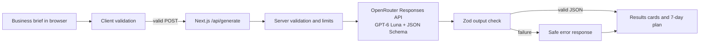

# AI Marketing Studio — Technical Spec

## How This Works, In Plain Language

The browser shows the business form and keeps the current brief and results in memory. A short privacy note explains that the brief is sent to OpenRouter and the selected upstream model for generation, is not saved by this app, and should not include confidential information or customer personal data. When the user generates a plan, the browser sends the brief to a small server route in this Next.js app. That route checks the brief, adds the private OpenRouter key, asks the configured model (default `openai/gpt-6-luna`) for one response in a fixed shape, checks that response, and sends only safe, structured results back to the browser. The browser displays the two platform cards and seven campaign days.

There is no account, database, or separate backend to configure. Refreshing the page clears the brief and results. That keeps the prototype small; the tradeoff is that campaigns are not saved. The OpenRouter key stays on the server and is never sent to the browser.

## The Core Journey Through the System

Implements `prd.md > The Core Journey`.

1. The browser loads the workspace, blank form, sample-business action, and empty results panel.
2. The user fills in or sample-loads the brief. The browser validates required fields and shows inline errors without sending a request when anything is missing.
3. On a valid submit, the browser disables the button and shows “Creating your marketing campaign…”. It sends `POST /api/generate` with the brief.
4. The Next.js route validates the JSON again, checks request size and server configuration, then calls OpenRouter’s Responses API with the GPT-6 Luna model and strict structured output.
5. The route verifies the response is complete, not a refusal, and matches the app’s Zod output schema, including exactly seven plan days and only the selected platforms. It returns JSON to the browser.
6. The browser replaces results only after a valid successful response. Copy actions use the Clipboard API. Editing and regenerating uses the updated brief.
7. If a request fails, the form and previous successful result remain in browser memory. The UI shows a plain-language error and Retry/Edit actions.



## Stack

| Layer | Choice | Why it fits |
| --- | --- | --- |
| App framework | Next.js App Router + TypeScript | Familiar to the learner; one app can serve the UI and a server-side API route. [Next.js](https://nextjs.org/docs/app) |
| UI styling | Tailwind CSS + shadcn/ui | Matches the preferred stack and supports a small, editable set of accessible UI components. [Tailwind with Next.js](https://tailwindcss.com/docs/installation/framework-guides/nextjs), [shadcn/ui for Next.js](https://ui.shadcn.com/docs/installation/next) |
| Input and output validation | Zod | Use the same typed schemas to validate browser requests, provider output, and tests. [Zod](https://zod.dev/) |
| AI client | OpenAI Node.js SDK pointed at OpenRouter's Responses API | One server-side request produces UI-ready JSON instead of fragile free-form parsing. Use the Responses parsing helper with `zodTextFormat`. [OpenRouter OpenAI SDK setup](https://openrouter.ai/docs/community/frameworks), [Structured Outputs](https://openrouter.ai/docs/guides/features/structured-outputs) |
| Model | `openai/gpt-6-luna` | The learner selected it as the starting model. It is configurable with `OPENROUTER_MODEL`; `recursive/flint-v1.0:free` and `openrouter/free` are also supported options. Model availability and structured-output behavior can change, so validate the response server-side. [GPT-6 Luna on OpenRouter](https://openrouter.ai/openai/gpt-6-luna), [Flint on OpenRouter](https://openrouter.ai/recursive/flint-v1.0%3Afree), [Free model router](https://openrouter.ai/openrouter/free) |
| Tests | Vitest + mocked provider calls, focused browser checks | Most repeatable tests avoid API charges; a small real API smoke check confirms key/model/schema setup. [Vitest](https://vitest.dev/), [Next.js testing guide](https://nextjs.org/docs/app/guides/testing) |
| Hosting | Vercel | The user wants a public app URL; deploy after local verification. [Vercel deployment](https://vercel.com/docs/deployments) |

The exact package versions will be those resolved by the current Next.js starter and package manager when the build begins. Check Node.js compatibility at setup; current Next.js installation guidance requires Node.js 20.9 or newer. [Next.js installation](https://nextjs.org/docs/app/getting-started/installation)

## Where It Runs and How Someone Tries It

- **Local development:** Node.js 20.9+, npm, and a terminal on the learner’s computer.
- **Install and run:** `npm install`, then `npm run dev`; open `http://localhost:3000`.
- **Live AI generation:** Set `OPENROUTER_API_KEY` in a root `.env.local` file. Do not prefix it with `NEXT_PUBLIC_`. Keep `.env.local` out of Git. Add `.env.example` with variable names and placeholders only, including `OPENROUTER_MODEL=openai/gpt-6-luna` and `GENERATION_ENABLED=true`.
- **Test without spending API credits:** `npm run test` runs Vitest with mocked provider responses. The app itself still requires a key for live generation; missing configuration produces a helpful service-unavailable error.
- **Deploy:** Import the public GitHub repository through Vercel’s web interface, set `OPENROUTER_API_KEY` in the project’s server-side environment variables, deploy, then run a real generation against the public URL. Configure and publish the WAF rule described under **Abuse safeguard** below.
- **Demo and submission:** The chosen public live URL complements the public repository and demo video; it does not replace the required short video or repository. The learner reports the hackathon expects an open-source license and a public demo video under three minutes. Verify the current event instructions during `6-ship`. Vercel Hobby is for personal or non-commercial use under its current terms; this hackathon prototype is planned as a non-commercial demo. The current terms also say Vercel may use Hobby-submitted content for model training, so use non-sensitive demo briefs and recheck plan/privacy terms before real business use. [Vercel terms](https://vercel.com/legal/terms)

## Look and Feel

Carry forward `prd.md > Look and Feel`: a light, modern, approachable SaaS workspace with a soft off-white canvas, white cards, charcoal text, subtle borders, and violet or indigo accents. Use a readable sans-serif, restrained rounding, and useful whitespace. Keep the business form left and results right on desktop, then stack form first and results directly below on mobile. Use clear state copy, visible focus rings, accessible labels, and text alongside error color. Use shadcn/ui only for the components needed by this one workspace; avoid adding a dashboard shell or analytics widgets.

## Components

### Marketing Studio page and brief form

`app/page.tsx` composes the client-side workspace. `components/marketing-studio.tsx` owns the brief, validation errors, loading flag, last successful result, and request error. It starts blank, loads the sample only when clicked, validates before submitting, and retains inputs/results across a failed request. It prevents duplicate submissions while loading. Show this privacy note near the form: “Your brief is sent to OpenRouter to generate content and is not saved by this app. Don’t enter confidential information or customer personal data.” For a Vercel Hobby deployment, add that the current hosting terms may allow submitted content to be used for model training. Implements `prd.md > Screens and Layout`, `Business Brief Form`, `Generation and Loading`, and `States and Boundaries`.

### Validation and sample data

`lib/marketing-schema.ts` defines shared Zod enums and schemas for the brief and generated result. `lib/sample-business.ts` holds the labeled coffee-shop example. Both client and server use the same brief validation rules: required business/product/audience, one allowed goal, at least one of Instagram/Facebook, Friendly as the tone default, and an offer when goal is “Promote a special offer.” Apply sensible field caps (business 120 chars; product, audience, and offer 300 chars each) and reject request bodies over 8 KB. These limits keep prompts and requests bounded; they are implementation defaults, not separate product features. Implements `prd.md > Business Brief Form` and `States and Boundaries`.

### Generation route and provider adapter

`app/api/generate/route.ts` accepts `POST` only. It parses a JSON brief, validates with Zod, checks `OPENROUTER_API_KEY` and `GENERATION_ENABLED`, calls `lib/openrouter-marketing.ts`, validates the returned object, and returns a normalized JSON result or safe error. `GENERATION_ENABLED=false` disables generation at the application level and is the emergency switch if public traffic or usage is unexpected; redeploy after changing the Vercel environment setting. Monitor provider usage in the OpenRouter dashboard because the IP rule is not a global spend cap. `lib/openrouter-marketing.ts` is the only module that imports the OpenAI-compatible SDK and reads the secret. It sends requests to `https://openrouter.ai/api/v1` and uses `OPENROUTER_MODEL` if supplied, otherwise `openai/gpt-6-luna`; `recursive/flint-v1.0:free` and `openrouter/free` are alternative values. Set the model server-side and never from a browser request. The prompt treats the business brief as data, asks for truthful promotional writing, and prohibits inventing prices, inventory, locations, guarantees, business facts, or measured outcomes. It must reflect the provided audience, goal, tone, and promotion accurately. Implements `prd.md > Social Content`, `Seven-Day Campaign Plan`, `Generation and Loading`, and `States and Boundaries`.

### Social content and campaign results

`components/results-panel.tsx`, `components/social-content-card.tsx`, and `components/campaign-day.tsx` render the structured result. Show a separate card only for each selected platform and show `campaignSummary` as the campaign objective. Each day is a compact expandable section, with idea, format, platform-tailored captions, CTA, and a metric labeled as something to track. The result schema requires the campaign plan to contain seven entries; the server also checks day order and selected-platform correspondence. Implements `prd.md > Social Content`, `Seven-Day Campaign Plan`, `Editing, Regeneration, and Copying`, and `Screens and Layout`.

### Clipboard and user feedback

`components/copy-button.tsx` copies a caption and exposes a short “Copied” confirmation; clipboard failure shows a manual-select hint. The main form presents “Creating your marketing campaign…” and disables the submit button during the request. A failed regeneration leaves the previous result visible with a previous-result label. Implements `prd.md > Generation and Loading`, `Editing, Regeneration, and Copying`, and `States and Boundaries`.

### Abuse safeguard

At deployment, configure one Vercel WAF fixed-window rule for `POST /api/generate`, keyed by source IP, with a starting threshold of 10 requests per 10 minutes and the default 429 action. This is a modest anonymous-demo limit; reviewers sharing one public IP could hit it together. Also keep server-side input/body caps and bounded model output. Vercel documents WAF rate limiting across plans, IP counting on Hobby, a limit of one rate-limit rule per Hobby project, and a pricing review during first-rule setup; its current page lists one million allowed requests included for Hobby, then $0.50 per additional million. Review the dashboard’s current terms and pricing before publishing the rule. The client must treat an HTTP 429 from the WAF as a rate-limit state even if the WAF response body is not the app’s JSON error envelope. [Vercel WAF rate limiting](https://vercel.com/docs/vercel-firewall/vercel-waf/rate-limiting)

## Data Model

### Business brief (browser and request)

```ts
type MarketingBrief = {
  businessName: string;
  productOrService: string;
  targetAudience: string;
  marketingGoal:
    | "brand_awareness" | "increase_sales" | "special_offer"
    | "engagement" | "leads" | "retention";
  platforms: ("instagram" | "facebook")[]; // one or both, no duplicates
  brandTone: "friendly" | "professional" | "playful" | "persuasive";
  offer?: string;
};
```

### Generated result (server response)

```ts
type MarketingResult = {
  campaignSummary: string;
  socialContent: Array<{
    platform: "instagram" | "facebook"; // exactly once per selected platform
    headline: string;
    caption: string;
    hashtags: string[]; // zero or more where appropriate
    callToAction: string;
  }>;
  campaignPlan: Array<{
    day: 1 | 2 | 3 | 4 | 5 | 6 | 7; // exactly seven, ascending
    contentIdea: string;
    format: string;
    captions: Array<{
      platform: "instagram" | "facebook"; // selected platforms only
      caption: string;
    }>;
    callToAction: string;
    suggestedMetric: string; // tracking suggestion, not a prediction
  }>;
};
```

All fields in `MarketingResult` are required. The `offer` field is optional in `MarketingBrief`, except when the user selects `special_offer`. The `hashtags` array may be empty. The Zod output schema is also supplied to OpenRouter Structured Outputs as a strict JSON Schema with a seven-item `campaignPlan`. Server-side checks confirm ascending day order and exact platform sets matching the brief because schema shape alone does not enforce those cross-field business rules. Structured Outputs guarantees supported schema adherence, not that advice is factual or effective. [Structured Outputs guide](https://openrouter.ai/docs/guides/features/structured-outputs)

### API contract: `POST /api/generate`

Request:

```json
{
  "brief": {
    "businessName": "Daily Grind Coffee",
    "productOrService": "Iced coffee and matcha latte",
    "targetAudience": "College students and young professionals",
    "marketingGoal": "special_offer",
    "platforms": ["instagram", "facebook"],
    "brandTone": "friendly",
    "offer": "10% off selected drinks this weekend"
  }
}
```

Success (`200`): `{ "result": MarketingResult }`.

Failure (`4xx`/`5xx`): `{ "error": { "code": string, "message": string, "retryable": boolean } }`. Codes: `INVALID_REQUEST` (`400`), `RATE_LIMITED` (`429`), `AI_NOT_CONFIGURED` or `GENERATION_DISABLED` (`503`), `AI_REFUSED` (`422`), `AI_INCOMPLETE` or `INVALID_AI_OUTPUT` (`502`), `AI_UNAVAILABLE` (`503`), `AI_TIMEOUT` (`504`), and `INTERNAL_ERROR` (`500`). Messages are written for users, contain no keys, raw provider payload, or stack trace. Preserve an upstream retry delay when available; otherwise give a general wait-and-retry message.

## OpenRouter Request and Response

The server calls `POST https://openrouter.ai/api/v1/responses` using the OpenAI Node SDK's Responses parsing helper with `zodTextFormat(MarketingResultSchema, "marketing_result")`, `model: process.env.OPENROUTER_MODEL ?? "openai/gpt-6-luna"`, `reasoning: { effort: "low" }`, `max_output_tokens: 5000`, `store: false`, instructions, and the validated brief. Treat 5,000 output tokens and low reasoning effort as starting values to check during the first real generation. Consume `response.output_parsed`; do not parse a free-form answer yourself. Require a completed response and non-null parsed output. Handle refusal and incomplete status separately. Do not enable tools or send data to browser code. OpenRouter provides an OpenAI-compatible endpoint and documents Responses Structured Outputs. Server-side Zod validation remains required, especially when changing models. [OpenRouter Responses API](https://openrouter.ai/docs/api/api-reference/responses/create-responses), [Structured Outputs](https://openrouter.ai/docs/guides/features/structured-outputs), [SDK setup](https://openrouter.ai/docs/community/frameworks)

**Retry policy:** Set SDK automatic retries to zero so retry ownership is explicit. The route may retry once for a transient network/timeout or provider 5xx; it does not automatically retry a 429, refusal, missing key, or invalid/incomplete output. The UI’s manual Retry reuses the preserved brief. A timed-out upstream call may have completed remotely, so the bounded automatic retry can still incur a duplicate charge; never retry in a loop. Keep a bounded output token limit appropriate to the seven-day result and check the live sample during the first real smoke test.

## Server Validation and Secret Handling

- Validate the same brief in the browser for immediate inline guidance and again in the server route because browser requests are untrusted.
- Enforce allowed enums, at least one unique supported platform, required strings, the special-offer conditional, character limits, JSON content type, and 8 KB body cap before calling OpenRouter.
- Validate the structured response with Zod after parsing and enforce exactly seven ordered days, one social item per selected platform, and one daily caption per selected platform.
- Read `OPENROUTER_API_KEY` only in the provider module on the server. `.env.local` is ignored by Git; `.env.example` contains placeholders only. Never use a `NEXT_PUBLIC_` secret or log prompts/results/provider bodies.
- Keep form and generated result only in React memory; no localStorage or database. On refresh, they reset. A failed request never clears current inputs or a previous successful result.
- Limit output generation to one in-flight client request. The WAF is one protection layer, not a global spending cap: multiple IPs can each generate requests and users behind one IP count together. Monitor OpenRouter usage and retain an application kill switch: set `GENERATION_ENABLED=false` in the server environment and redeploy to disable generation if usage is unexpected. Local development has no shared rate-limit store.
- Show a short privacy note near the form explaining that brief data is sent to OpenRouter, is not saved by this app, and should not include confidential information or customer personal data. On Vercel Hobby, include the hosting terms warning about possible model training on submitted content; use non-sensitive demo inputs and recheck terms before production use.

## Failure Handling

| Failure | Server response / user experience |
| --- | --- |
| Invalid brief or oversized body | `400 INVALID_REQUEST`; inline client errors for normal form use; route rejects forged requests without exposing details. |
| Missing API key | `503 AI_NOT_CONFIGURED`; say generation is not configured and the brief is safe. No automatic retry. |
| Emergency generation switch is off | `503 GENERATION_DISABLED`; explain that generation is temporarily paused. No automatic retry. |
| WAF limit reached / provider 429 | `429 RATE_LIMITED`; tell the user to wait and try later. Preserve brief and previous results. |
| Timeout, network error, or provider 5xx | One bounded transient retry at the server; if still failing, return safe retryable error and show Try again/Edit brief. |
| Refusal, incomplete response, or output failing Zod/cross-field checks | Normalize to a safe `422`/`502` error; do not display raw provider text; allow manual retry. |
| Clipboard unavailable | Keep result visible and show a hint to select and copy the caption manually. |

Implements `prd.md > States and Boundaries` and `Editing, Regeneration, and Copying`.

## Testing and Verification

- **Vitest unit tests (no API cost):** brief validation including every required field and offer condition; output shape and seven-day/platform cross-checks; sample brief; prompt construction invariants against invented facts; normalized provider errors; UI/API behavior with a mocked provider.
- **Focused manual browser pass:** blank state, sample fill/edit, each goal/validation state, Instagram-only, Facebook-only and both platforms, success, copy confirmation, regeneration with changed input, simulated failure preserving form and earlier results, mobile stacking, and keyboard focus/error announcement.
- **Small real API smoke test:** with a private local `.env.local`, make one coffee-shop generation and inspect schema validity, accurate offer, selected platform count, and seven complete days. A second run only if the first reveals a configuration or output issue. Avoid real requests in routine tests.
- **Deployment check:** after Vercel environment variable and WAF rule are configured, test a single real generation on the live URL, verify a missing/invalid configuration produces a safe state where practical, and confirm 429 handling without repeatedly hitting the provider.

The content-quality check is a human review of one small sample, not proof that every recommendation is correct or effective. Schema validation proves shape and required app rules, not marketing performance.

## File Structure

```text
learn-ai-basics/
├── app/
│   ├── api/
│   │   └── generate/
│   │       └── route.ts          # POST endpoint; server validation and safe errors
│   ├── globals.css               # Tailwind theme and light visual direction
│   ├── layout.tsx                # document shell, fonts, metadata
│   └── page.tsx                  # workspace entry point
├── components/
│   ├── ui/                       # only shadcn/ui primitives actually used
│   ├── marketing-studio.tsx      # client form state and submit/retry flow
│   ├── business-brief-form.tsx   # fields, goals, platform selection, validation
│   ├── results-panel.tsx         # empty/error/success/previous-result states
│   ├── social-content-card.tsx   # platform-specific copy card
│   ├── campaign-day.tsx          # expandable daily plan entry
│   └── copy-button.tsx           # clipboard and copied feedback
├── lib/
│   ├── marketing-schema.ts       # brief and strict output Zod schemas/types
│   ├── sample-business.ts        # explicit demo example data
│   ├── openrouter-marketing.ts   # server-only SDK call and prompt
│   └── utils.ts                  # shadcn utility helper if generated
├── tests/
│   ├── marketing-schema.test.ts  # input/output and cross-field rules
│   └── generate-route.test.ts    # mocked provider and safe API errors
├── devpost/
│   ├── learner-profile.md
│   ├── scope.md
│   ├── scope.html
│   ├── prd.md
│   ├── prd.html
│   ├── spec.md
│   └── spec.html
├── .env.example                  # setting names and placeholders, never a real key
├── .gitignore                    # excludes .env.local and generated files
├── package.json                  # scripts: dev, build, lint, test
├── tsconfig.json
├── vitest.config.ts
└── README.md                     # setup, environment, run, test, deploy notes
```

## External Services and Dependencies

### OpenRouter API

- **Call:** Responses API `POST /v1/responses`; one generation call per valid submission, with at most one server retry for transient failures.
- **Authentication:** `OPENROUTER_API_KEY` on the server only.
- **Endpoint:** `https://openrouter.ai/api/v1/responses` through the OpenAI-compatible Node SDK.
- **Model:** `openai/gpt-6-luna` starting default, configurable server-side through `OPENROUTER_MODEL`; alternatives are `recursive/flint-v1.0:free` and `openrouter/free`.
- **Payload:** validated brief in the prompt; strict JSON Schema format for `MarketingResult`; bounded output tokens.
- **Response:** completed response with parsed `MarketingResult`, or refusal/incomplete/error mapped to the API contract above.
- **Cost:** token-based and depends on the selected model; both named `:free` options are currently listed as free. Check current model pricing and limits before a public launch. [GPT-6 Luna on OpenRouter](https://openrouter.ai/openai/gpt-6-luna), [Flint free model](https://openrouter.ai/recursive/flint-v1.0%3Afree), [Free model router](https://openrouter.ai/openrouter/free)
- **Data path:** user-entered business details are sent to OpenRouter and the selected upstream model for generation. This prototype does not save those details itself.

### Vercel

- Hosts the Next.js app and server route.
- Holds `OPENROUTER_API_KEY` as a server-side project environment variable.
- Provides the public URL and the configured WAF request rule. Current Vercel terms limit Hobby to personal/non-commercial use; current WAF rate-limit pricing/limits are linked above and should be checked in the project dashboard before applying the rule.

No database, authentication service, analytics provider, social network API, or separate backend is used in the MVP.

## What Was Simplified and Why

- **In-memory brief/results** instead of accounts and saved campaigns — proves generation and recovery without a database or identity flow; data resets on refresh.
- **One synchronous Responses call** instead of agents, queues, streaming, or multiple model calls — both outputs are coordinated from one brief and one response.
- **Suggested metrics only** instead of social integrations/live analytics — no account permissions or unsupported performance claims.
- **Vercel dashboard WAF rule** instead of adding a rate-limit database/service — provides a basic public endpoint limit without new app infrastructure; local development does not share a global quota.
- **Mocked provider in routine automated tests** instead of frequent real calls — predictable tests without routine token charges; one real smoke test verifies integration.

## Decisions and Open Issues

- **Learner decisions:** Next.js/TypeScript, Tailwind/shadcn, OpenRouter Responses API + Structured Outputs, GPT-6 Luna, no database/auth, Vitest and manual verification, local-first build, and a public Vercel demo. The public repo must have an open-source license and the video must be public and under three minutes per the learner’s hackathon guidance; confirm exact event rules during `6-ship`.
- **Implementation details derived from those choices:** same Zod schemas at the browser/server boundary; one route; 8 KB request cap and field caps; strict output schema; safe normalized errors; one explicit server retry maximum; WAF fixed-window 10 requests/IP/10 minutes for `POST /api/generate` as the initial public-demo rule.
- **Useful unknown:** No separate technical concept was identified as uncertain during this spec discussion. The first live generation should still trace one parsed OpenRouter result through the Zod schema into the UI, since seeing that connection supports the learner’s stated goal of understanding how specs become code.
- **Open:** No architecture decision remains open. Confirm current package/model and Vercel plan/rate-limit pricing during setup/deployment because these can change. No live API key is needed in the spec or chat.
